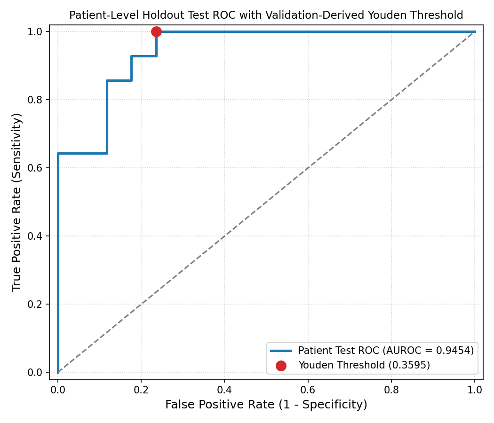
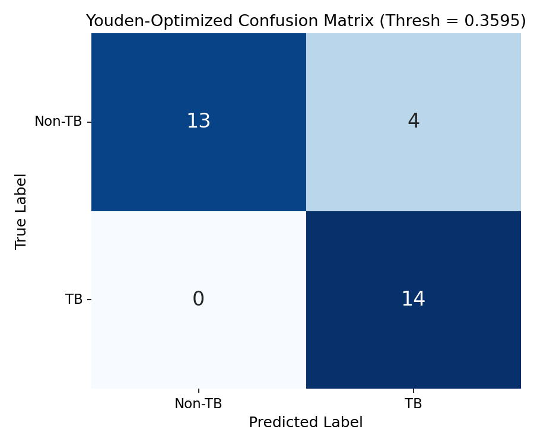
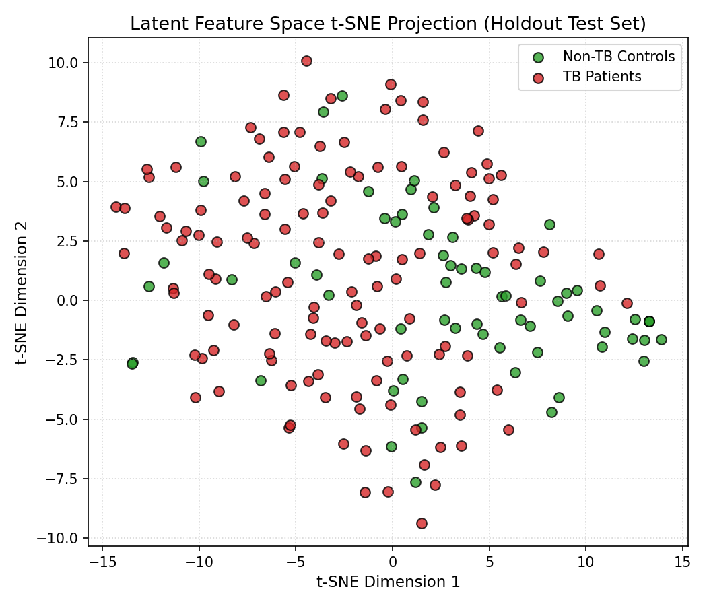
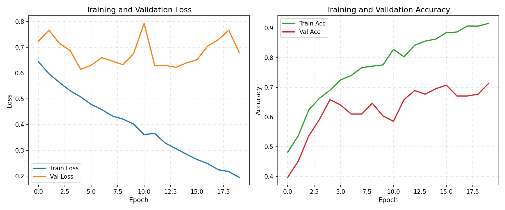

# RespiScan: Environmentally Robust Tuberculosis Screening from Cough Acoustics

RespiScan is a lightweight, edge-compatible deep learning framework designed to screen for Tuberculosis (TB) using cough acoustic signatures. By converting 1D audio signals into 2D Continuous Wavelet Transform (CWT) scalograms and applying a fine-tuned MobileNetV2 architecture, the system extracts pathological respiratory biomarkers while minimizing environmental noise and processing bias.

To ensure clinical viability, RespiScan addresses key methodological limitations in existing literature by enforcing:
1. **Strict Subject-Level Splitting:** Guaranteeing zero speaker leakage between train, validation, and test sets.
2. **Consistent CWT Preprocessing:** Standardizing all inputs using complex Morlet wavelets (`cmor1.5-1.0`) to eliminate toolchain processing bias.
3. **Class-Balanced Environmental Noise Mixing:** Training with real-world noise backgrounds at 10 dB SNR to build robustness for outpatient clinics.
4. **Clinical Decision Boundary Calibration:** Calibrating decision thresholds via validation-derived Youden's Index to prioritize high screening sensitivity.

---

## 📊 Performance Summary (Patient-Level Holdout Test, n = 31)

The model is evaluated on an independent holdout test set containing 31 unseen subjects (14 TB patients, 17 Healthy controls) using direct confusion matrix metrics and **95% Wilson Score Confidence Intervals**:

| Diagnostic Metric | Default Threshold ($\theta = 0.50$) | Youden-Optimized Threshold ($\theta = 0.3595$) | Clinical Significance |
| :--- | :---: | :---: | :--- |
| **Patient Accuracy** | 77.42%<br>(95% CI: 60.19%–88.61%) | **87.10%**<br>(95% CI: 71.15%–94.87%) | Overall diagnostic correctness on unseen patients. |
| **Sensitivity (Recall)** | 50.00%<br>(95% CI: 26.80%–73.20%) | **100.00%**<br>(95% CI: 78.47%–100.00%) | Triage rate (minimizes False Negatives / missed cases). |
| **Specificity** | **100.00%**<br>(95% CI: 81.57%–100.00%) | **76.47%**<br>(95% CI: 52.74%–90.45%) | Selectivity rate (minimizes healthy referrals). |
| **Positive Predictive Value (PPV)**| 100.00%<br>(95% CI: 64.57%–100.00%) | **77.78%**<br>(95% CI: 54.78%–91.00%) | Probability that a positive AI result is truly TB. |
| **Negative Predictive Value (NPV)**| 70.83%<br>(95% CI: 50.83%–85.09%) | **100.00%**<br>(95% CI: 77.19%–100.00%) | Probability that a negative AI result is truly healthy. |
| **Patient AUROC** | 0.9454 | 0.9454 | Threshold-independent discriminative capacity. |

---

## 🖼️ Publication Plots

### 1. Patient-Level Holdout Test ROC & Youden Calibration
The decision threshold of **0.3595** was derived on the validation set using Youden's Index ($J = \text{TPR} - \text{FPR}$) to maximize sensitivity for a triage pre-screening setup.


### 2. Youden-Optimized Confusion Matrix
At $\theta = 0.3595$, the system achieves 100.00% Sensitivity (FN = 0), capturing 14 active TB patients in the holdout test cohort.


### 3. Latent Feature Space t-SNE Clustering
Visualizing the 1280-dimensional global average pooling features using t-SNE reveals an **observable clustering tendency** and partial visual separation between Healthy controls (green) and TB patients (red).


### 4. Training and Validation Learning Curves
The training loss shows stable convergence, with validation-level AUROC monitored to trigger early stopping at epoch 12.


---

## 📁 Repository Structure

```
├── 1_Data_Standardization_and_Acoustic_Preprocessing.ipynb  # Audio standardization & CWT extraction
├── 2_MobileNetV2_Scalogram_Training_and_Clinical_Evaluation.ipynb # Training, Youden tuning & testing
├── 3_Dual_Branch_Feature_Fusion_Model_Training.ipynb        # Multi-modal fusion experiments
├── 4_Ablation_Study_Focal_Loss_and_Feature_Cleaning.ipynb    # Loss function & feature investigations
├── 5_Comparative_Analysis_ResNet18_vs_MobileNetV2.ipynb     # Model benchmark vs ResNet18
├── Fig1_ROC_Patient_Optimized.png                           # Patient-level ROC plot
├── Fig_Confusion_Matrix_Patient.png                         # Youden confusion matrix heatmap
├── Fig_tSNE_Acoustic_Clusters.png                           # 2D t-SNE feature cluster plot
├── Fig3_Training_Validation_Curves.png                      # Training history curves
├── journal_draft_respiscan.md                               # Complete manuscript draft
├── clinical_evaluation_report.md                            # Clinical metrics reference guide
├── metodologi_lengkap_respiscan.md                         # Detailed methodology manual (ID)
├── modelbuild.py                                            # Backbone architecture definitions
├── requirements.txt                                         # Python dependency file
└── best_RespiScan_MobileNetV2_Scalogram.pth                 # Best MobileNetV2 PyTorch weights (11.7 MB)
```

---

## ⚙️ Installation & Execution

### 1. Clone Repository & Setup Environment
```bash
git clone https://github.com/primeell/PENELITIAN-TBC-SCREENING.git
cd PENELITIAN-TBC-SCREENING
pip install -r requirements.txt
```

### 2. Run Pipeline Notebooks
Follow the numerical sequence of Jupyter notebooks in the root directory:
* Run `1_Data_Standardization_and_Acoustic_Preprocessing.ipynb` to process raw audio databases (Coswara/TBscreen) into mono, 16 kHz, 1-second wav files, and save CWT scalograms as 224x224 images.
* Run `2_MobileNetV2_Scalogram_Training_and_Clinical_Evaluation.ipynb` to train MobileNetV2, perform validation-level decision thresholding, and test on the holdout partition.

---

## 🔬 Model Specifications
* **Architecture:** MobileNetV2 (ImageNet pre-trained backbone, customized fully-connected classifier head with Dropout $p=0.5$).
* **Model Size:** 11.7 MB (standard float32 PyTorch weights).
* **Parameters:** 2.2 Million.
* **Loss Function:** Weighted Cross-Entropy (Healthy weight: 2.0, TB weight: 1.0).
* **Optimizers:** Adam (Backbone Learning Rate: $10^{-5}$, Classifier Head Learning Rate: $10^{-4}$).

---

## 📝 Authors & Citation
* **G. E. F.** - Conceptualization, preprocessing, model development, evaluation, and draft writing.
* **H. P.** - Supervision, methodology validation, manuscript review.
