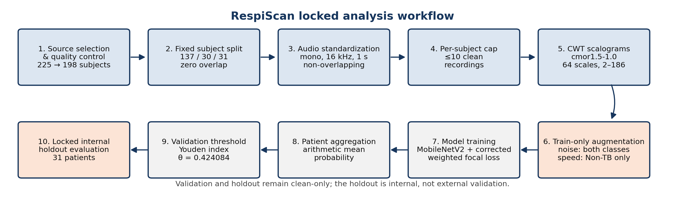
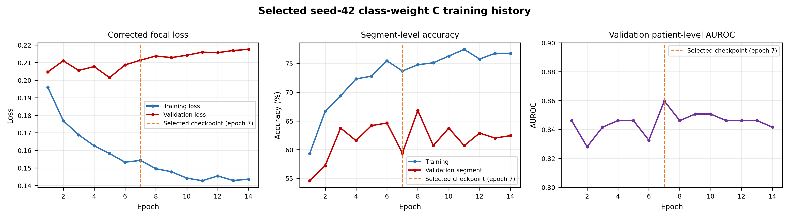

# RespiScan

**Research-stage tuberculosis triage from cough acoustics, with a mobile and edge-AI implementation.**

RespiScan transforms short cough recordings into Continuous Wavelet Transform (CWT) scalograms and evaluates them with a MobileNetV2 model. The project is designed as **decision support for research-stage triage**, not as a diagnostic device and not as a replacement for clinical assessment, microbiology, radiology, or clinician judgement.

> **Clinical-use notice** — The final evidence is an internal 31-subject holdout evaluation. The system has no prospective external validation and must not be represented as clinically ready or used as a stand-alone diagnostic tool.

## At a glance

| Item | Final locked value |
|---|---|
| Cohort and split | 198 subjects; 137 train / 30 validation / 31 internal holdout |
| Model | ImageNet-pretrained MobileNetV2; 512-unit ReLU + Dropout 0.5 classifier |
| Training loss | Corrected weighted focal loss, gamma = 2.0 |
| Selected class weights | Non-TB : TB = **1.5 : 1.0** |
| Patient-level aggregation | Arithmetic mean of valid cough-level TB scores |
| Decision threshold | **0.424084**, selected on validation with Youden index before holdout evaluation |
| Internal holdout AUROC | **0.8866** (95% CI 0.7479–0.9832) |
| Internal holdout sensitivity / specificity | **71.43% / 82.35%** |
| Internal holdout confusion matrix | TN = 14, FP = 3, FN = 4, TP = 10 |

## Final research workflow

The final configuration was chosen through validation-only class-weight ablation, locked before test evaluation, and then assessed once on the internal holdout.



<details>
<summary><strong>How to read the result</strong></summary>

- **AUROC** describes discrimination across thresholds.
- **Sensitivity and specificity** above use the single validation-derived threshold of 0.424084.
- The reported holdout is **internal** and small; confidence intervals are therefore wide.
- A model score is not a calibrated clinical probability and should not be interpreted as one.
</details>

## What is in this repository?

```text
.
├── RespiScanMobile/                  Android app, TARA UI, and edge/IoT implementation
├── PAKET_REVISI_JURNAL_RESPISCAN/    Curated manuscript-revision package and final figures
├── reviewer_revision_outputs/        Auditable experiment outputs, locks, scripts, and reports
├── 1_...ipynb to 5_...ipynb          Historical exploration and development notebooks
├── run_pipeline_leak_free.py          Subject-disjoint research pipeline
├── prepare_kaggle_dataset.py          Dataset preparation helper
├── docs/                              Start here for workflow, app, reproducibility, and release guidance
└── README.md                          Project overview and final-result summary
```

The notebooks and several files at repository root document development history. They are **not** the source of the final claims. Use the locked artifacts and reports listed below when reviewing the final model.

## Start here

| Goal | Recommended document |
|---|---|
| Understand the research question, methodology, results, and limitations | [Research workflow](docs/RESEARCH_WORKFLOW.md) |
| Install or build the Android RespiScan application | [Mobile application guide](docs/MOBILE_APPLICATION.md) |
| Reproduce or audit the final selection and evaluation | [Reproducibility guide](docs/REPRODUCIBILITY.md) |
| Navigate the repository and distinguish final vs. historical files | [Repository map](docs/REPOSITORY_MAP.md) |
| Publish an installable APK professionally through GitHub Releases | [Release checklist](docs/RELEASE_CHECKLIST.md) |

## Android application

The current mobile build is **RespiScan v2.3.0 — Cough Gate**. It contains the locked ONNX model, the 0.424084 decision threshold, multi-cough averaging, and a conservative pre-inference recording-quality gate.

The APK should be distributed as a **GitHub Release asset**, not committed into source history. This keeps the source repository lightweight and makes the download path clear for users. Full installation, integrity, and build instructions are available in the [mobile application guide](docs/MOBILE_APPLICATION.md).

## Edge and IoT demonstration

The repository also contains an optional offline-first deployment called **TARA / SAPA-TB**:

```text
Touch display + microphone → Radxa ROCK 4 SE → local CWT + ONNX inference
                                      ├── SQLite store-and-forward
                                      ├── ESP32/TFT status display
                                      └── laptop monitoring dashboard
```

Inference remains local on the edge node; MQTT transports metadata only. See [RespiScanMobile/README.md](RespiScanMobile/README.md) for the node architecture and [deployment documentation](RespiScanMobile/docs/DEPLOYMENT_RUNBOOK.md) for setup.

## Engineering highlights

- **Reproducible ML decisions:** patient-disjoint split, validation-only configuration selection, and immutable threshold/model locks.
- **On-device inference:** Android ONNX runtime with CWT preprocessing and multi-cough score aggregation.
- **Input-quality controls:** a conservative recording-quality gate before model inference, with documented scope and limitations.
- **Edge deployment:** offline-first Radxa workflow with local SQLite persistence, MQTT synchronization, ESP32 display, and a laptop operations dashboard.
- **Traceable research communication:** final figures, reviewer-response trail, technical audits, and explicit limitations are linked from this repository.

## Final figures

| Workflow | Internal-holdout ROC |
|---|---|
|  |  |

| Training curves | Internal-holdout confusion matrix |
|---|---|
|  |  |

## Evidence trail

The manuscript revision is organized into four auditable stages:

1. **Data and baseline audit** — subject split, leakage prevention, preprocessing, augmentation, and historical-code audit.
2. **Class-weight selection** — restricted A/B/C ablation on validation only; configuration C selected and locked.
3. **Robustness and bias analysis** — bootstrap confidence intervals, multi-seed validation, source-domain analysis, error analysis, and calibration audit.
4. **Manuscript and reviewer revision** — consistency audit, final figures, and point-by-point reviewer responses.

Read [the revision-package index](PAKET_REVISI_JURNAL_RESPISCAN/REPORT_INDEKS_TAHAP_1_SAMPAI_4.md) for the complete trail. The final configuration and performance table are also summarized in the [resubmission readiness report](reviewer_revision_outputs/RESUBMISSION_READINESS_REPORT.md).

## Key limitations

- Internal holdout is limited to 31 subjects; performance uncertainty remains substantial.
- Acquisition source and disease label are partially confounded in the available data.
- No prospective, external, multi-site, or clinical workflow validation has been performed.
- The mobile Cough Gate is a signal-based quality screen, **not** a clinically validated cough detector.
- Use is limited to research, engineering demonstration, and future validation work.

## Project status

The analytical revision package is internally consistent and ready for resubmission after author, affiliation, contribution, conflict-of-interest, and final comparison-table checks are confirmed. See [the readiness report](reviewer_revision_outputs/RESUBMISSION_READINESS_REPORT.md) for the exact remaining manual checks.

## Citation and contact

If you build on this work, please contact the repository owner before citing or redistributing the model, application, or research artifacts. A formal citation record should be added after the manuscript’s author list and publication details are finalized.
