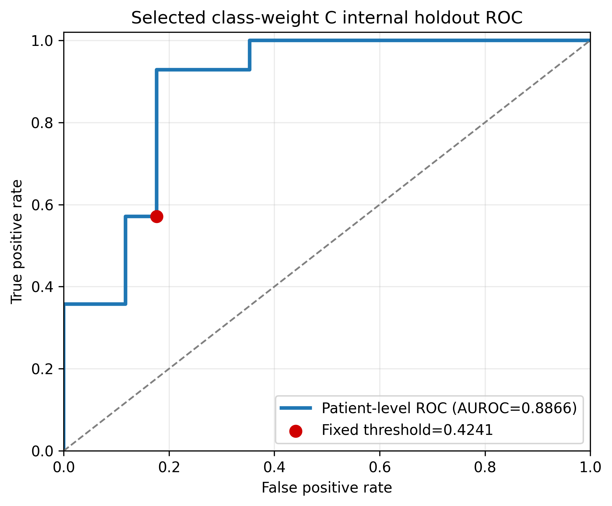
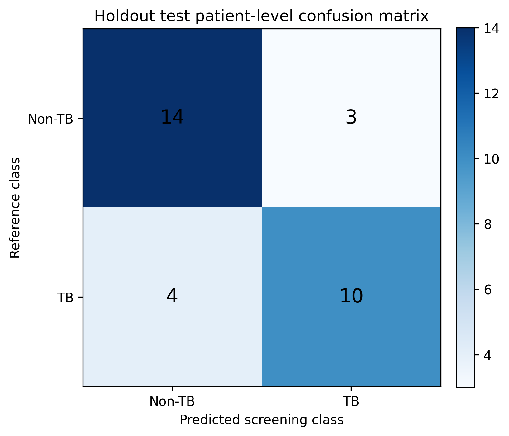

# Research workflow and final results

This guide explains the evidence path behind the final RespiScan configuration. It is the recommended entry point for research reviewers, recruiters, and technical collaborators.

## Research question

Can a lightweight CWT–MobileNetV2 pipeline distinguish TB and Non-TB cough recordings at the patient level while preserving subject-disjoint evaluation and an auditable threshold-selection process?

RespiScan is a research-stage triage-support system. It is not a medical device and does not establish a diagnosis.

## Final pipeline

```text
Audio recording
  → standardization (mono, 16 kHz)
  → 1-second cough segment
  → CWT scalogram (224 × 224 RGB)
  → ImageNet-pretrained MobileNetV2
  → cough-level TB score
  → arithmetic mean across valid coughs
  → threshold 0.424084
  → triage-support category
```

## Data partition and anti-leakage rule

The fixed subject-disjoint split contains 198 active subjects:

| Partition | Subjects | Role |
|---|---:|---|
| Train | 137 | Parameter optimization |
| Validation | 30 | Checkpoint choice, class-weight comparison, and threshold selection |
| Internal holdout | 31 | One-time final evaluation only |

No subject may appear in more than one partition. The class-weight decision was written to a selection lock before test predictions were enumerated or evaluated.

## Model-selection protocol

All settings except class weight were held fixed. Three configurations were compared using patient-level validation results:

| Configuration | Non-TB weight | TB weight | Selection status |
|---|---:|---:|---|
| A | 1.0 | 1.0 | Compared on validation only |
| B | 2.0 | 1.0 | Compared on validation only |
| C | 1.5 | 1.0 | **Selected** |

Selection rule:

1. validation sensitivity must be at least 90%;
2. among eligible models, choose highest validation specificity;
3. break ties by AUROC, then TB F1.

Configuration C met this rule with validation sensitivity 100%, specificity 76.47%, AUROC 0.8597, and TB F1 0.8667. The selected threshold, derived by validation Youden index, is 0.4240843266.

## Locked configuration

| Component | Final setting |
|---|---|
| Backbone | MobileNetV2, ImageNet-pretrained |
| Classifier | 1280 → 512 → ReLU → Dropout 0.5 → 2 logits |
| Loss | Corrected weighted focal loss, gamma = 2.0 |
| Class weights | Non-TB : TB = 1.5 : 1.0 |
| Optimizer | Adam |
| Learning rates | Backbone 1e-5; classifier 1e-4 |
| Batch size / maximum epochs | 32 / 30 |
| Early stopping | Patience 7; validation patient-level AUROC |
| Aggregation | Arithmetic mean of valid cough-level TB scores |
| Threshold | 0.4240843266; validation-derived Youden index |

## Internal-holdout results

The final evaluation was performed once on 31 internal-holdout subjects.

| Metric | Value |
|---|---:|
| AUROC | 0.8866 (95% CI 0.7479–0.9832) |
| Accuracy | 77.42% (95% CI 61.29%–90.32%) |
| Sensitivity | 71.43% (95% CI 50.00%–92.86%) |
| Specificity | 82.35% (95% CI 64.71%–100.00%) |
| TB precision | 76.92% |
| TB F1 | 74.07% |
| Confusion matrix | TN = 14, FP = 3, FN = 4, TP = 10 |





## What the figures do—and do not—show

- The ROC and confusion matrix are **patient-level internal-holdout** results.
- The training curves are from the selected seed-42 configuration.
- Source-probability and reliability figures are exploratory diagnostics, not evidence of clinical calibration.
- No final claim should use the historical root-level threshold 0.3595 or the older root-level figures.

## Evidence locations

| Question | Source of truth |
|---|---|
| Selection rule and lock | `reviewer_revision_outputs/class_weight_selection_lock.json` |
| Final test metrics | `reviewer_revision_outputs/class_weight_selected_test_metrics.csv` |
| Final technical consistency | `reviewer_revision_outputs/RESUBMISSION_READINESS_REPORT.md` |
| Four-stage audit trail | `PAKET_REVISI_JURNAL_RESPISCAN/REPORT_INDEKS_TAHAP_1_SAMPAI_4.md` |
| Model export / ONNX parity | `RespiScanMobile/TARA_MODEL_EXPORT_VERIFICATION.json` |

## Limitations and next work

The project requires external validation, prospective studies, site/device diversity, clinically representative negative controls, and a separately trained cough-versus-non-cough model before clinical deployment can be considered. These limitations are not implementation defects; they are boundaries of the available evidence.
